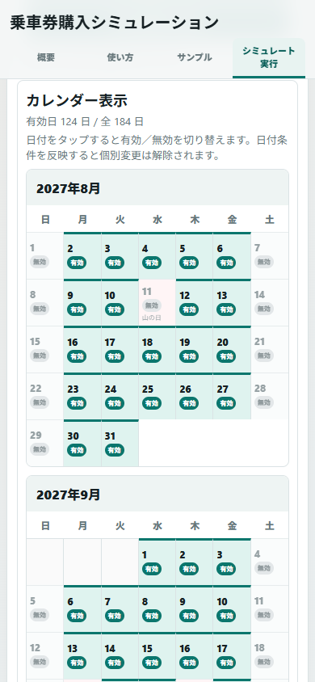
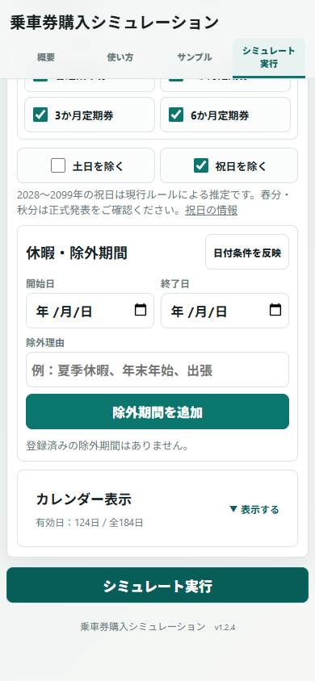

# v1.2.4 — CALENDAR & PDF UX IMPROVEMENT

ローカル実装・関連テスト完了。確認日：2026年11月1日（日本時間）。Git commit・push・公開は行っていません。作業開始時の作業ツリーはクリーン（ace8409）でした。

## 変更ファイル

| ファイル | 内容 |
| --- | --- |
| index.html | 折りたたみカレンダー、PDF見出し・選択欄・2ボタン・保存説明、v1.2.4表記 |
| script.js | 開閉状態と日数表示、期間内の週だけを描画、計算日時・購入明細の保存と共用、全パターン比較・差額・購入順・普通乗車券小計のPDF出力 |
| style.css | 220ms開閉、動き抑制、カレンダー見出し、PDFボタン縦並びと48px以上の操作領域 |
| verification/test-calendar-pdf-ux.cjs（追加） | カレンダー・スクロール削減・保存データ共用・全パターンPDFの専用検証 |
| verification/test-samples.cjs | 既存計算結果・購入フロー回帰の記録先をv1.2.4へ変更 |
| verification/test-experience.cjs | 条件表示・設定復元・40プラン検証の記録先を変更 |
| verification/test-beginner-ui.cjs | 保存欄の5選択肢と画面記録先を更新 |
| verification/test-compact-ui.cjs | v1.2.3の計算・サンプル・復元を保護し、画面記録先を更新 |
| verification/test-route-samples.cjs | v1.2.3実区間マスター回帰の記録先・表示を更新 |
| verification/test-pdf-output.cjs | 全パターン専用ボタンとPDF記録先を更新 |
| verification/ui-helpers.cjs | 日付編集を行う既存テストではカレンダーも明示展開 |
| verification/check-route-pdf-render.py | 16PDFの日本語・金額・ページ構成・継続表と画像化検証 |
| V1.2.4_REPORT.md（追加） | 本報告 |

検証結果JSON・画面／PDF画像は verification/v124-* に保存しました。過去バージョンの画像・計算結果・報告書は書き換えていません。本体は従来のHTML・CSS・JavaScriptの3ファイル構成を維持しています。外部ライブラリ・ビルド環境・外部APIを追加していません。

## カレンダー改善

詳細設定内のカレンダーは初期状態を閉じ、見出し全体を操作できるボタンにしました。閉じた状態で「カレンダー表示」「有効日：○日 / 全○日」「▼ 表示する」を表示します。開くと「閉じる」に変わります。

- 高さと透明度を220msで変化させ、連続操作中も切り替えられます。動きを減らす設定ではアニメーションを抑制します。
- 日付データとカレンダー表示状態を分けているため、開閉だけでは入力・個別日・計算条件を変更しません。
- 日付タップ、有効／無効、祝日・休暇の表示と除外、個別変更、条件再反映を維持しました。
- サンプル切り替え・個別変更時に有効日数を更新します。閉じた内容は高さ0となり、キーボードの移動対象からも外します。
- 期間の最初と最後の月は、対象日を含む週だけを描画します。表示対象外の月や丸ごとの空白週を表示しません。
- Enter／Spaceでも開閉できます。メニュー切り替えによって入力や開閉状態をリセットしません。

## 390px幅での改善前後

同じ01サンプル・2027/08/01〜2028/01/31・390×844px・詳細設定を開いた状態で比較しました。

| 測定項目 | v1.2.3 | v1.2.4・カレンダーを閉じた状態 |
| --- | ---: | ---: |
| カレンダー内容の高さ | 約2,391px | 0px |
| カレンダーパネル全体 | 約2,512px | 96px |
| 見出しから実行ボタンまでの距離 | 約2,526px | 98px |
| この位置から実行ボタン全体までの追加スクロール | 約1,852px | 0px |

見出しから実行ボタンまでの距離は約2,428px短くなりました。閉じた状態から実行ボタンまでカレンダー6か月分をスクロールする必要がありません。実測値は [検証JSON](verification/v124-calendar-pdf-checks.json) に記録しています。

| 変更前・390px | 変更後・390px |
| --- | --- |
|  |  |

[展開したカレンダー](verification/v124-390-calendar-open.png)も確認できます。画面末尾までの長さが異なるため、比較画像のスクロール位置はブラウザーが許す範囲内です。距離の実測は同じ見出しとボタンから取得しています。

## PDF保存の実装方式・操作

既存のブラウザー印刷方式を維持しました。クリック／タップに続けて別画面を開き、日本語を含む印刷用HTMLを表示し、フォント準備後に印刷画面を開きます。利用者が印刷画面でPDFの保存先を指定する構成です。別画面にも「印刷・PDFに保存」ボタンを残しています。

計算結果の冒頭に以下を配置しました。

- 見出し：シミュレーション結果をPDF保存
- 選択欄：保存する購入パターン
- ボタン1：選択した購入パターンをPDF保存
- ボタン2：全購入パターンをまとめてPDF保存

ボタンはPC・スマートフォン共通で縦並び、48px以上の高さと10pxの間隔を確保しました。計算前・条件変更後は両方を無効化します。ポップアップを開けないときは操作場所にエラーを表示します。

Windows Chromeは送信先の「PDFに保存」を選ぶ短い説明を常時表示します。iPhoneの共有・ファイル保存方法は折りたたみ補足で案内します。iPhoneの具体的な表示・操作はOSのバージョンにより異なるため、実機での確認対象としています。

[390pxのPDF保存欄](verification/v124-390-pdf-actions.png) ／ [1280pxのPDF保存欄](verification/v124-1280-pdf-actions.png)

## PDFに含まれる情報

| 共通条件 | 内容 |
| --- | --- |
| 日時 | シミュレーション日時とPDF出力日時を分けて日本時間で記載 |
| 区間・定期種別 | サンプルの横浜 ⇔ 東京・JR東海道線、通勤／通学（大学）、大学生向け購入条件 |
| 金額 | 片道・往復普通運賃、1・3・6か月定期代 |
| 日程 | 対象期間、有効曜日、祝日・土日の扱い、休暇／除外期間と理由、個別有効・無効日、乗車日数 |
| 使用条件 | 比較対象の券種、サンプル名と変更済み表示 |

| パターン別 | 内容 |
| --- | --- |
| 比較 | 購入方法の名称、総購入金額、最安方法との差額。同額は「同額」 |
| 定期券 | 種類・購入順・購入日・有効開始／終了日・1枚ごとの購入額・対象利用日数 |
| 普通乗車券 | 利用日数と合計額、正確な利用日一覧。有効期間は各利用日当日 |
| スケジュール | 上から順に購入する表と合計行。普通乗車券が連続する購入区間だけをまとめて表示 |

最安探索から外した券種も、既存仕様の参考比較として生成した結果を保存します。対象外と明記し、選択範囲の最安より安い参考額は負の差額で表示します。差額0円を節約額として強調しません。

手動入力・旧保存結果で区間や通勤／通学種別が記録されていない場合は「未設定（入力金額で計算）」と表示します。区間情報を推測して付ける処理は追加していません。

## 全パターンPDFのページ構成

全パターン専用ボタンでは、次の5件を単一PDFへまとめます。最安プランと特定券種のみが同額でも、それぞれの計算結果として記載します。

1. 最安購入方法
2. 普通乗車券のみ
3. 1か月定期券のみ
4. 3か月定期券のみ
5. 6か月定期券のみ

**1ページ目は比較一覧と共通条件、2ページ目以降は各購入方法の詳細**です。各パターンは新しいページから始まり、長い表は継続します。表見出しを繰り返し、行の途中の分割を避ける印刷スタイルを維持しています。

実生成では、01の6か月分は6ページ（比較1ページ＋詳細5ページ）、06を2030/01/31まで延長したケースは8ページになりました。どちらも比較一覧は1ページ目、最初の詳細は2ページ目でした。延長ケースでは継続表ヘッダー2ページを確認しました。

[比較一覧の1ページ目](verification/v124-pdf-all-comparison.png) ／ [詳細の2ページ目](verification/v124-pdf-all-detail.png) ／ [長い表の継続ページ](verification/v124-pdf-continuation.png)

## 計算結果データの共用と互換性

最安探索・日付の探索・運賃計算は変更していません。従来のPDF購入プラン生成処理を計算結果の表示時に実行し、全5件の購入明細・購入日・期限・単価・合計を結果データへ保存するよう整理しました。

PDFの保存操作は保存済み明細を読み取り、合計と利用日被覆の整合性を検証します。PDF保存時に最安探索や購入日・単価の計算をやり直しません。日付／運賃計算の関数をすべて失敗する状態にしても、選択・全パターンのPDFモデルとHTMLを作れることをテストしています。

普通乗車券の小計や差額は、保存済みステップの金額と最安金額の集計・比較です。ユーザーの画面入力が後から変わっても、計算時の保存条件を使用します。

v1.2.3から復元した旧結果には、画面復元時に既存の生成ルールで明細を準備します。記録のない過去の計算日時は「未記録（旧バージョンの計算結果）」と表示します。ユーザーの金額・日付・休暇の保存キーや初期値は変更していません。

## 8サンプルの維持確認

基準日2026/11/01・対象期間2027/08/01〜2028/01/31。v1.2.3の運賃マスター、曜日、休暇、個別日と、最安金額・購入フロー・全40比較プランを照合しています。

| サンプル | 最安金額 | 最安方法 | v1.2.3との比較 |
| --- | ---: | --- | --- |
| 01 毎日通勤する会社員 | 79,650円 | 6か月定期券 × 1枚 | 一致 |
| 02 長期休暇のある大学生 | 41,450円 | 1か月定期券 × 2枚 ＋ 3か月定期券 × 1枚 | 一致 |
| 03 週3日出勤 | 78,144円 | 普通乗車券（往復） × 74日 | 一致 |
| 04 週2日出勤 | 52,800円 | 普通乗車券（往復） × 50日 | 一致 |
| 05 月によって出勤日数が変動 | 70,848円 | 普通乗車券（往復） × 8日 ＋ 1か月定期券 × 4枚 | 一致 |
| 06 1か月の長期出張 | 75,660円 | 1か月定期券 × 2枚 ＋ 3か月定期券 × 1枚 | 一致 |
| 07 土日を含む勤務 | 79,650円 | 6か月定期券 × 1枚 | 一致 |
| 08 途中から在宅勤務 | 70,860円 | 普通乗車券（往復） × 25日 ＋ 3か月定期券 × 1枚 | 一致 |

定期券・普通乗車券の5種類の組み合わせも維持しました。計算エンジンとサンプル定義は、v1.2.3ソースとの一致を検証しています。サンプル読込後の自動計算は行わず、「シミュレート実行」を押す既存動作を維持します。

## 自動テスト結果

| テスト | 結果 |
| --- | --- |
| test-calendar-pdf-ux.cjs | 初期閉状態、タップ・キーボード・開閉・連打、日付変更／日数の保持、部分月・空白週、8結果／40プラン一致、PDF保存時に再計算しないこと、計算日時と出力日時、選択／全保存、参考額・同額・負の差額、エラー、6画面幅、220msアニメーション：成功 |
| test-samples.cjs | 元計算エンジンでの8件の最安金額・購入フロー一致、曜日・休暇・今回の発見：成功 |
| test-experience.cjs | 設定の退避・切替・再読み込み・復元、8条件表示、40プラン・利用日被覆・期限、3タイムゾーンの日付初期化：成功 |
| test-beginner-ui.cjs | メニュー・手動入力・エラー・結果・線表／カレンダー・保存操作、5画面幅・タッチ：成功 |
| test-compact-ui.cjs | 既存カード開閉・連打・スクロール・入力レイアウト・詳細設定、5パターンPDF画面、LF：成功 |
| test-route-samples.cjs | 全8件の実運賃・区間・通勤／大学、保存互換性、5組み合わせ、40PDFモデル、外部自動取得なし：成功 |
| test-pdf-output.cjs | 実PDF14件、全8件の最安と02の全比較、06延長全パターン、07普通乗車券：成功 |
| check-route-pdf-render.py | 専用UIテスト分2件を含む **16PDF・全28ページ** の日本語・金額・ページ内配置・比較1ページ目／詳細2ページ目・継続表：成功 |
| node --check script.js ／ git diff --check | 成功 |

印刷用HTMLからの実PDF生成にはローカルChromeを使用しました。全ページの一覧画像と、比較・詳細・大学生・長い表を画像で目視確認しています。注意書きだけが次ページへ送られたケースは、行間とセル余白を調整して再生成し、最終版では解消しました。

[PDF全ページ一覧](verification/v124-pdf-overview.png)、[PDF検証JSON](verification/v124-pdf-render-checks.json)、[カレンダー／PDF UX検証JSON](verification/v124-calendar-pdf-checks.json)、[全購入プラン](verification/v124-route-results.json)を残しています。

## スマートフォン表示と未確認事項

- ローカルのindex.htmlを直接開いて検証しました。320・375・390・740・768・1280px幅で、閉／開カレンダーとPDFボタンの横はみ出しがないことを確認しています。
- 390pxのタッチ相当環境で、カード・条件読込・日付変更・開閉・実行・PDF保存ボタンを確認しました。
- **iPhone実機・Safariでの検証は実施していません。** Chromeのモバイル・タッチ相当設定による確認です。Safariでのアニメーション、日付入力、印刷プレビューの共有・ファイル保存は実機確認が必要です。
- WindowsのOS印刷ダイアログを操作して最終ファイルを保存する部分は未確認です。新しい印刷用画面の表示、自動印刷呼び出し、実PDFファイル生成までは自動確認しています。最終の保存名・保存先はブラウザーと利用者の操作に依存します。
- 手動入力では区間／定期種別の入力欄を追加していないため、記録がない情報はPDFに未設定と表示します。
- 運賃マスター、2028年以降の祝日推定、月加算、同額の最安1案表示など、既存の計算仕様を維持しています。

PDF画像検証のレンダラーは一時的なQA用です。アプリ依存は追加せず、生成済み中間PDFと一時レンダラーは確認後に削除しています。再検証時には、既存のPlaywright環境と、画像検証用PyMuPDF／Pillowが必要です。

## 改行コード

既存の.gitattributesを維持し、変更・追加したテキストファイルをLFで確認しました。.editorconfigはありません。無関係な既存ファイルの改行は変更していません。

## ユーザー確認手順（5項目）

1. index.htmlをPC Chromeで開き、01サンプルを読んで「詳細設定」を開く。カレンダーが閉じ、日数と実行ボタンが見つけやすいことを確認する。
2. カレンダーを開いて日付を1つ切り替える。日数が変わり、閉じて開き直しても変更が保持されることを確認する。
3. 「シミュレート実行」を押し、PDF保存欄で購入パターンを選び「選択した購入パターンをPDF保存」を押す。印刷画面で保存し、金額・購入日・期限を確認する。
4. 「全購入パターンをまとめてPDF保存」を押し、1ページ目の比較一覧と2ページ目以降の全5購入方法を確認する。
5. iPhone Safariでもカレンダー開閉、実行ボタンへの移動、両PDFボタンと共有からのファイル保存を確認する。
