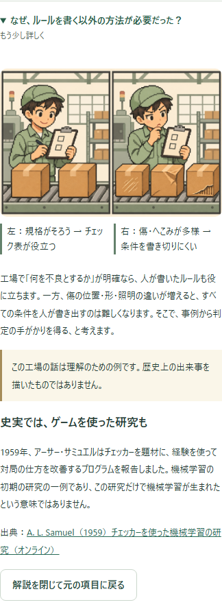
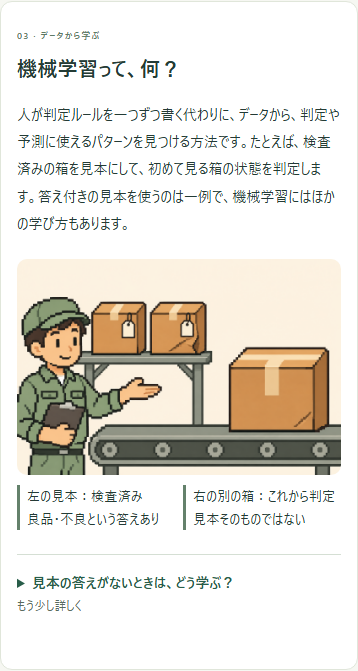
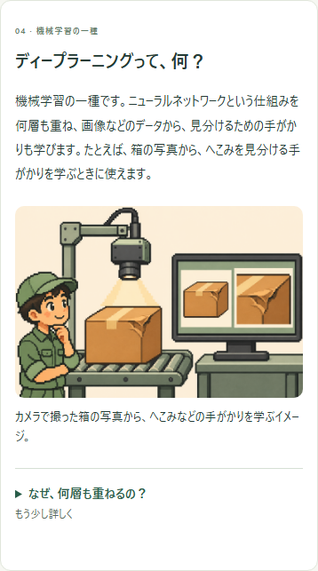

# v0.1.6 実装報告

第0章「G検定とAIの全体像」を追加した。初回ホームから概要を読み、気になる項目だけ深掘りし、工場の第1話・第2話へ進める。オリジナルのドット絵3点を実際に制作し、PNGでアプリへ組み込んだ。

## 1本の操作手順

ホーム「3分で全体像を見る」→G検定・AI・機械学習・ディープラーニングの4項目と入れ子図を読む→任意で「もう少し詳しく」を開き、閉じて元の項目へ戻る→「第1話で、AIの学び方を試す」→3コマ漫画→「仕分け台へ行く」→「最初の箱を流す」→「検査済みの箱を見本に加える」→判定の変化→搬送記録のグループ分け→2経路の点数比較→「出荷を見届ける」→3方式を振り返り「ここで終える」。深掘り・試験問題は選ばなくても完了できる。

第0章末尾の「第2話で、AIの性能を確かめる」からは、100箱の試運転→見逃しの発見→A/B比較→結末へ進める。両話の「第0章で用語を確認」は寄り道の入口で、「第0章を閉じて戻る」で元の場面・操作・位置を復元する。

## 制作・組み込んだ画像

制作機能は組み込みimage_gen。各画像を別々に生成して目視確認し、同じ配信のpublic/illustrationsへ保存した。実行時の外部画像取得や生成API接続はない。代替テキストと状態ラベルはHTMLに置いた。[全最終プロンプトと制作記録](ASSETS_v0.1.6.md)を保存している。

| ファイル | 対応する説明 | 本文と組み合わせた画面 |
| --- | --- | --- |
| [rules-vs-examples.png](../public/illustrations/rules-vs-examples.png) | ルールが役立つ規格のそろった箱と、傷・へこみが多様で条件を書き切れない箱の2コマ | [390px](screenshots/v0.1.6/guide-rules-390-chromium.png) / [320px](screenshots/v0.1.6/guide-rules-320-chromium.png) |
| [ml-inspected-samples.png](../public/illustrations/ml-inspected-samples.png) | 検査済み見本と、それとは別の未判定箱 | [390px](screenshots/v0.1.6/guide-ml-390-chromium.png) / [320px](screenshots/v0.1.6/guide-ml-320-chromium.png) |
| [dl-box-feature.png](../public/illustrations/dl-box-feature.png) | 箱を撮るカメラ、箱全体とへこみの拡大を見るモニター | [390px](screenshots/v0.1.6/guide-dl-390-chromium.png) / [320px](screenshots/v0.1.6/guide-dl-320-chromium.png) |

画像は各1536×1024 px。落ち着いた緑・茶・クリームを共通にし、検査員の帽子・作業着・箱・コンベアを統一。既存L003の静的なAI試行場面へ見本用PNGを転用し、ホームの装飾も同じ絵へ変更した。携帯幅のホームでは装飾を隠し、本文へ重ねない。L003の箱位置・最近傍・散布図、L004の100箱・判定ラベル・A/B集計は計算から描画する機能的な図として維持した。

### ルールの深掘り：本文と挿絵

### 機械学習：本文と見本・別の箱

### ディープラーニング：本文と撮影・へこみの手がかり

ほかの画面：[新規ホーム](screenshots/v0.1.6/guide-home-390-chromium.png)、[第0章全体と包含図](screenshots/v0.1.6/guide-overview-390-chromium.png)、[L003へ転用した場面](screenshots/v0.1.6/ai-trial-chromium.png)、[320px・文字200%の包含図](screenshots/v0.1.6/guide-ai-320-large-chromium.png)、[同じ条件の見本図](screenshots/v0.1.6/guide-ml-320-large-chromium.png)、[オフライン表示](screenshots/v0.1.6/guide-offline-chromium.png)。WebKit版も同じフォルダのwebkit-mobile画像に保存。

## 変更ファイル

- `src/components/BeginnerGuide.tsx`：4項目、包含図、内部解説、出典、位置・フォーカス復元、共用挿絵、2話への入口。
- `src/App.tsx`：初回の主ボタン、ホーム・コースの第0章入口、両話からの寄り道、背後の状態保持。直近に学んだ話を示して再開・やり直し。
- `src/components/EvaluationEpisode.tsx`：第0章への入口。
- `src/components/ShippingPrologue.tsx`：静的なAI試行の図を見本のPNGへ置換。
- `src/style.css`：第0章、入れ子枠、画像とラベル、320px・文字拡大、ホームの読みやすさ。
- `public/illustrations/`：上記3点の新規PNG。
- `tests/guide.spec.ts`：新規入口、深掘り、状態と位置の復帰、オフライン、320px・文字拡大、直近の再開先。
- `tests/helpers.ts`、`tests/{episode,evaluation,restart,story}.spec.ts`：新しい入口を通る回帰テストとv0.1.6の画像保存先。既存の計算・履歴・完了・演習の検証を維持。
- `scripts/verify-menu.mjs`：メニュー用の/app/配下で、両ブラウザの相対画像・オフライン・L003入口を確認。
- `package.json`、`package-lock.json`：v0.1.6。依存追加なし。
- `README.md`、`docs/ARCHITECTURE.md`、`docs/{SPEC_v0.1.6,CONTENT_GUIDE,ASSETS_v0.1.6,QA_REPORT_v0.1.6}.md`、本報告：操作・出典・設計・制作・検証。
- `docs/screenshots/v0.1.6/`：本文と画像を合わせた第0章、既存2話の回帰画面。
- `app/index.html`、`app/assets/`、`app/illustrations/`、`app/sw.js`：tool-labメニュー版を更新。親メニューの既存リンクは維持。

## 保存と既存機能

第0章閲覧ではDB・回答・完了を更新しない。元画面をマウントしたまま非表示にし、操作状態を保持する。第0章のスクロールをL003の読書位置へ保存しない。WebKitでも開いたボタンへ戻れるよう、クリック元を直接記憶する。

DB版1・バックアップ形式版1、旧場面ID、L003の12問と選択肢解説、L004の3問、任意演習、回答履歴、完了記録、復習候補、設定、JSON復元と統合を維持。第0章の閲覧をレッスン解放条件にはしていない。

## 検証結果

[検証報告](QA_REPORT_v0.1.6.md)に全条件を記載した。単体5ファイル45件、E2E72件（Chromium36件・WebKit36件）が成功。通常版・メニュー版のビルドも成功し、SWを含む12ファイルがバイト単位で一致した。メニュー版/app/配下の相対画像・オフライン・L003への入口も両ブラウザで確認した。

390px・320px・本文200%相当の表示、旧版の途中再開、両話の操作状態と保存データを保つ寄り道、履歴・復習候補・バックアップ、演習なしの完了を確認。本文と画像を合わせたスクリーンショットは86枚保存した。

iPhone実機は未確認。WebKitのiPhone相当設定での検証を、実機確認とは扱っていない。第0章の開閉状態・読書位置は再読込をまたぐ保存対象にしていない。外部出典はオンライン時に開く。

commit・push・公開は実施していない。変更したテキストはLF。
