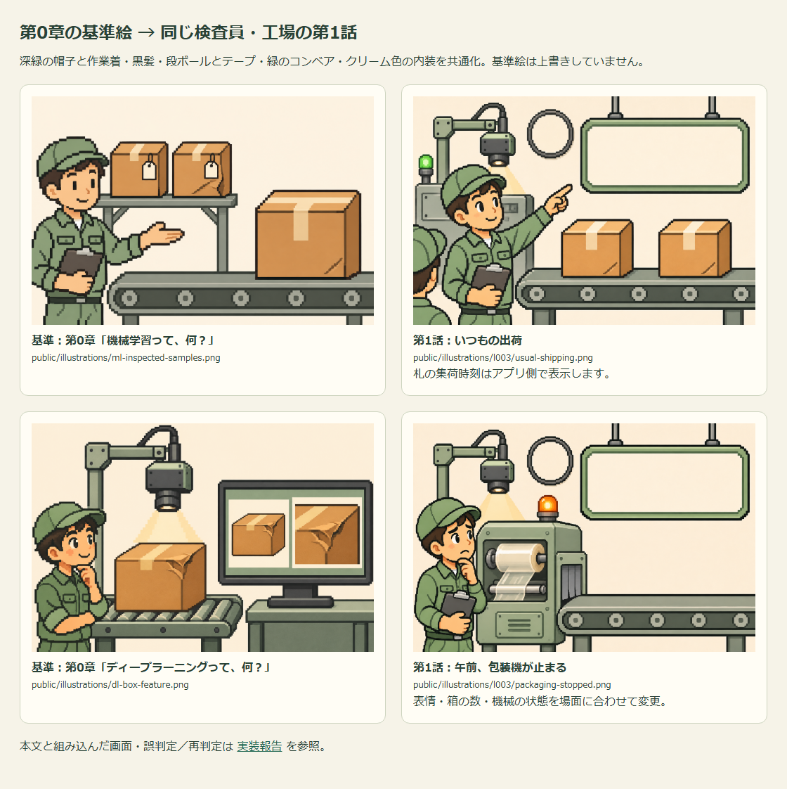
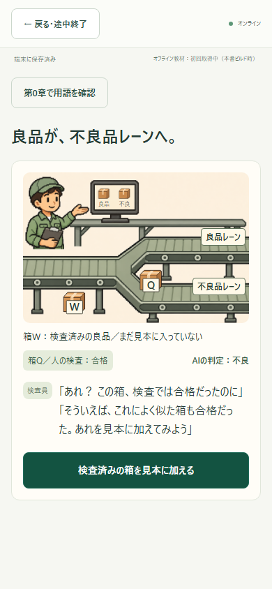
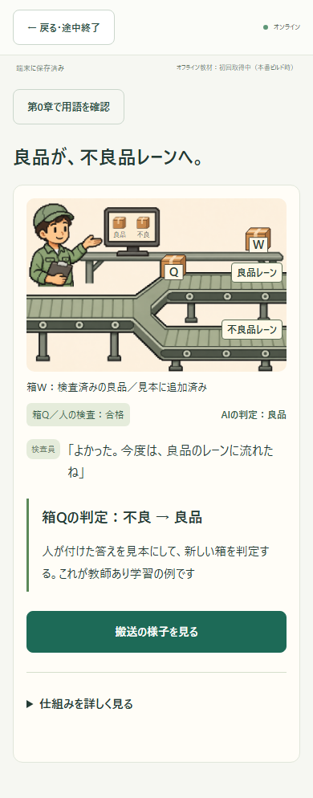

# v0.1.7 実装報告

第0章の実画像を参照し、L003冒頭の3コマから誤判定・見本追加・再判定までの挿絵を統一した。新規PNG5点を制作してアプリへ組み込み、第0章の既存画像は保持した。

## 操作手順

ホーム「3分で全体像を見る」→第0章「第1話で、AIの学び方を試す」→いつもの出荷→包装機停止→15時の箱の到着→「仕分け台へ行く」→AIの見本と別の箱Qを見る→「最初の箱を流す」→人は合格・AIは不良、Qが不良品レーンへ→「検査済みの箱を見本に加える」→別の箱Wが見本位置へ移り、同じQが良品レーンへ移る。

以降は従来のL003後半へ続けられる。「続きから学ぶ」は操作後の状態を復元し、「最初から学ぶ」はプロローグから未追加状態で再体験できる。

## 基準絵と新しい絵

`src/components/BeginnerGuide.tsx`が実際に読む以下の画像をview_imageで確認し、画像生成にも参照として渡した。

- [機械学習の基準絵](../public/illustrations/ml-inspected-samples.png)
- [ディープラーニングの基準絵](../public/illustrations/dl-box-feature.png)

緑の帽子と作業着、黒髪・目と顔つき、箱とクリーム色のテープ、くすんだ緑のコンベア、クリーム色の内装、階段状の輪郭と陰影を共通にした。表情・構図・箱の数は場面に合わせて変えた。

[比較ページ](ARTWORK_COMPARISON_v0.1.7.html)も保存。日本語・時刻・箱ID・判定ラベルは画像へ焼き込まず、HTML/SVGの文字で表示する。[制作手段・参照画像・全最終プロンプト](ASSETS_v0.1.7.md)を記録した。制作には組み込みimage_genを使用し、出力を目視確認してローカルへ保存した。

## 新規画像のパスと使用場面

| ファイル | 使用場面 | サイズ |
| --- | --- | --- |
| [public/illustrations/l003/usual-shipping.png](../public/illustrations/l003/usual-shipping.png) | いつもの出荷。検査員が集荷札を指して作業を教える | 1536×1024、1,653,939 bytes |
| [public/illustrations/l003/packaging-stopped.png](../public/illustrations/l003/packaging-stopped.png) | 午前、包装機の警告灯と空のベルト | 1536×1024、1,615,096 bytes |
| [public/illustrations/l003/boxes-arriving.png](../public/illustrations/l003/boxes-arriving.png) | 同じ包装機の復旧と箱の列、現在15時・集荷16時 | 1536×1024、1,666,133 bytes |
| [public/illustrations/l003/sorting-background.png](../public/illustrations/l003/sorting-background.png) | AI試行・誤判定・再判定で共通の検査員・モニター・分岐ベルト | 1536×1024、1,513,313 bytes |
| [public/illustrations/l003/box-sprite.png](../public/illustrations/l003/box-sprite.png) | Q・W・見本の独立部品。透明PNG、IDは別の文字 | 1312×1199、1,009,723 bytes |

第0章の3点の画像について、GitのHEADと差分がないことを確認。今回の画像は別ディレクトリへ追加した。第1話後半と第2話の挿絵・計算図を全面描き直す変更は行っていない。

## アプリに組み込んだ画面

| 場面 | 390px | 320px |
| --- | --- | --- |
| いつもの出荷 | [画面](screenshots/v0.1.7/opening-1-390-chromium.png) | [画面](screenshots/v0.1.7/opening-1-320-chromium.png) |
| 包装機停止 | [画面](screenshots/v0.1.7/opening-2-390-chromium.png) | [画面](screenshots/v0.1.7/opening-2-320-chromium.png) |
| 15時に到着 | [画面](screenshots/v0.1.7/opening-3-390-chromium.png) | [画面](screenshots/v0.1.7/opening-3-320-chromium.png) |
| AIを試す | [画面](screenshots/v0.1.7/trial-390-chromium.png) | [画面](screenshots/v0.1.7/trial-320-chromium.png) |
| 誤判定 | [画面](screenshots/v0.1.7/sorting-before-390-chromium.png) | [画面](screenshots/v0.1.7/sorting-before-320-chromium.png) |
| 再判定 | [画面](screenshots/v0.1.7/sorting-after-390-chromium.png) | [画面](screenshots/v0.1.7/sorting-after-320-chromium.png) |

WebKit版も同じフォルダの`webkit-mobile`画像に保存している。

### 誤判定：同じQが不良品レーンへ

### 再判定：Wを加えると同じQが良品レーンへ

## 計算との連動・互換性

`ShippingStory`が既存の`shippingPrediction(sampleAdded)`を呼び、その結果のlabelを`SortingArtwork`へ渡す。描画は固定PNG背景と別の箱image要素を合成し、labelからQの座標を決める。追加後もQの画像URLと背景URLは変わらない。Wは別要素として位置と追加済み表示を変える。

既存の最近傍分類で、不良から良品へ変化することを単体テストで維持。QとWは異なる特徴量・IDで、Wだけを追加する。結果のハードコードやQの正解付き登録は追加していない。

保存フィールド・場面ID・バックアップ形式の変更なし。途中再開、やり直し、回答履歴、完了、復習候補、設定、JSON復元・統合、第0章との往復、L003後半とL004の任意演習を回帰確認した。新画像は同じ配信から読み、実行時に画像生成APIや外部画像サイトへ接続しない。

## 変更ファイル

- `src/components/ShippingArtwork.tsx`：3コマのPNG・HTML札・SVG時計と、固定背景＋箱部品＋計算結果による位置・文字の描画。
- `src/components/ShippingPrologue.tsx`：3コマとAI試行を新しい絵へ接続。
- `src/components/ShippingStory.tsx`：誤判定・再判定を新しい描画へ接続し、人の確認とAI判定を分ける。
- `src/style.css`：画像・札・時計・レーン名・説明の配置。
- `public/illustrations/l003/`：新規5PNG。既存の第0章画像は不変。
- `tests/artwork.spec.ts`：390/320の全導線、画像の読み込み、Qの画像・背景の不変、結果との一致、透明部品、オフライン・再開・再開始。
- `tests/{episode,evaluation,guide,restart,story}.spec.ts`：ラベル・描画要素への確認を合わせ、画像保存先をv0.1.7へ変更。実際の変更対象はGit差分で確認可能。
- `src/App.tsx`、`package.json`、`package-lock.json`：v0.1.7表記。依存追加なし。
- `README.md`、`docs/ARCHITECTURE.md`、v0.1.7の仕様・制作記録・比較ページ・実装報告・検証報告・スクリーンショットとテストログ。
- `app/`：メニュー用ビルドを更新。親メニューの既存リンク先は維持。

## 検証結果

単体45件成功。E2EはChromium39件・WebKit39件、合計78件成功。通常版・メニュー版ビルド成功。メニューの/app/配下でも相対画像・オフライン・L003への導線を両ブラウザで確認。[詳細な検証結果](QA_REPORT_v0.1.7.md)と[全E2Eログ](test-logs/e2e-v0.1.7.txt)を保存した。

390px・320pxで画像と本文・操作ボタンを確認し、3コマは縦スクロールで読める。文字200%相当の既存回帰テストも成功。iPhone実機は未確認。改行はLF。commit・push・公開は実施していない。
